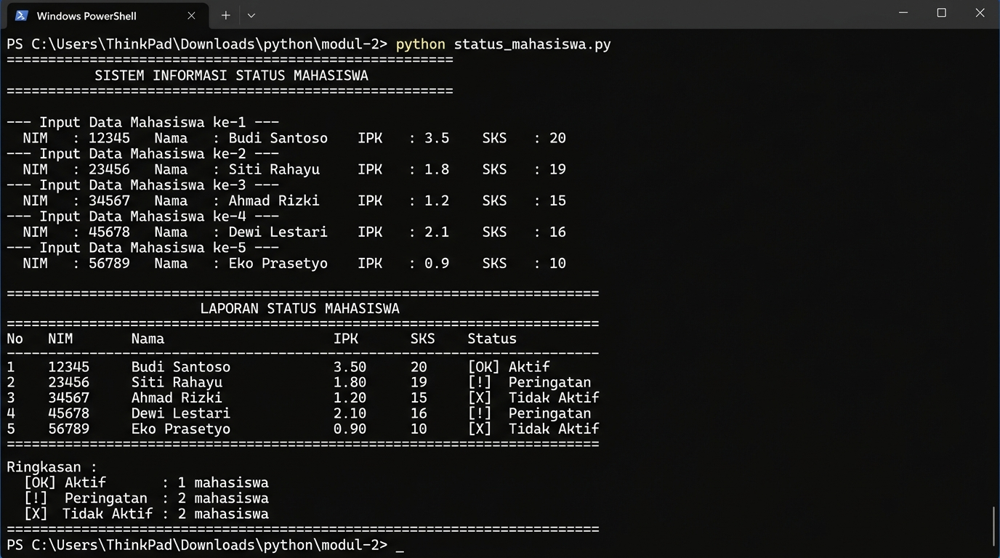
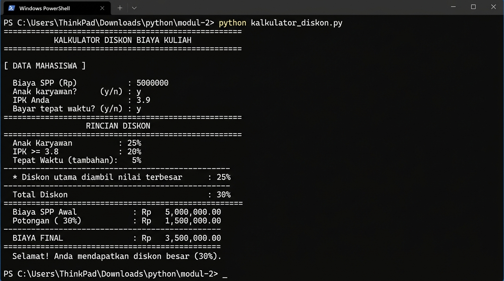
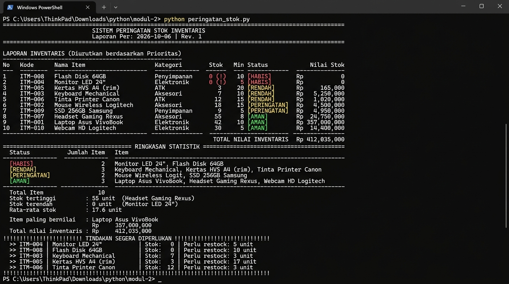
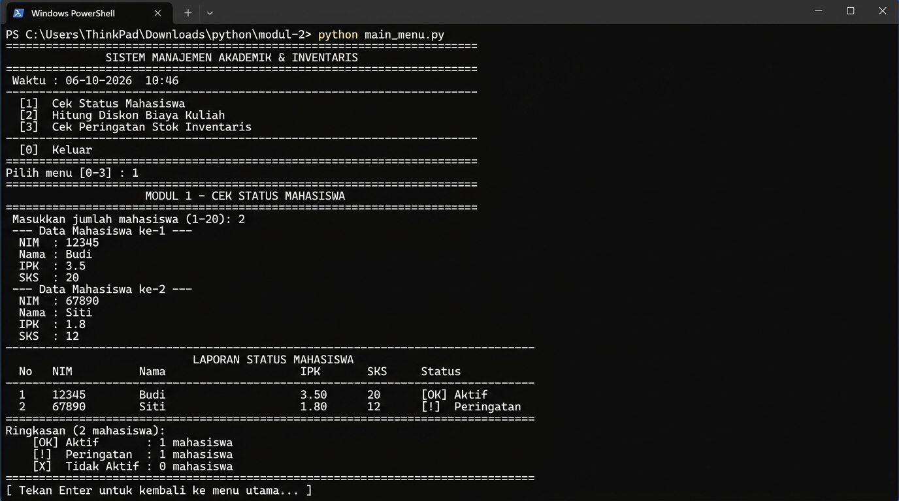
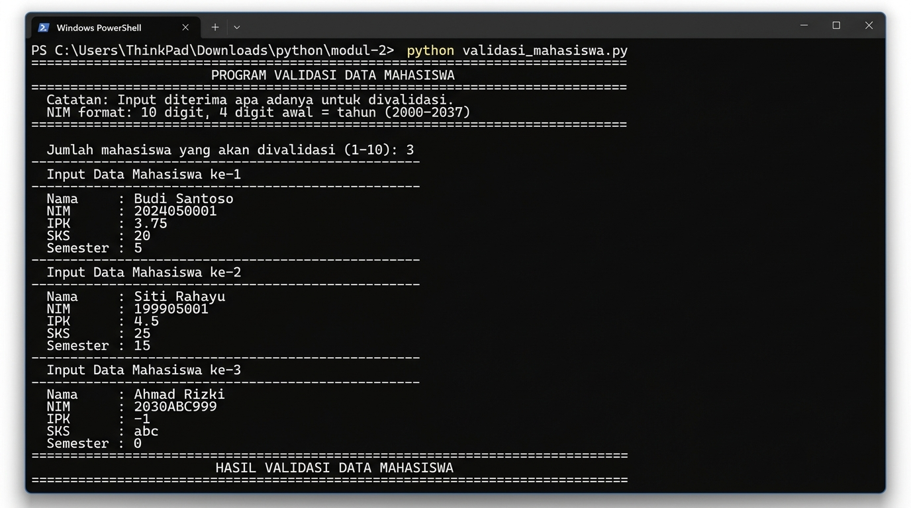
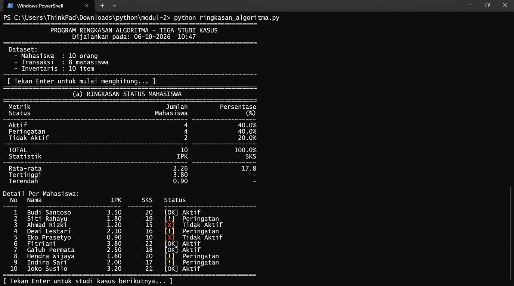

# Modul 2: Struktur Kontrol Alur & Logika Keputusan (Python)

Repositori ini berisi kumpulan program Python untuk penerapan struktur kontrol percabangan (`if`, `elif`, `else`), perulangan (`for`, `while`), penanganan error (`try-except`), validasi data input, serta pelaporan data tabular.

---

## Daftar Program & Fitur

| No | File Program | Deskripsi Singkat |
|:--:|---|---|
| 1 | [`status_mahasiswa.py`](file:///status_mahasiswa.py) | Penentuan status akademik mahasiswa berdasarkan IPK dan jumlah SKS |
| 2 | [`kalkulator_diskon.py`](file:///kalkulator_diskon.py) | Perhitungan diskon biaya kuliah (SPP) berdasarkan beberapa kriteria |
| 3 | [`peringatan_stok.py`](file:///peringatan_stok.py) | Sistem peringatan level stok inventaris berdasarkan rasio stok minimum |
| 4 | [`main_menu.py`](file:///main_menu.py) | Menu CLI interaktif modular yang menggabungkan seluruh studi kasus |
| 5 | [`validasi_mahasiswa.py`](file:///validasi_mahasiswa.py) | Validasi komprehensif format input data mahasiswa (NIM, IPK, SKS, Semester) |
| 6 | [`ringkasan_algoritma.py`](file:///ringkasan_algoritma.py) | Ringkasan terpadu, pemrosesan batch, dan analisis statistik ketiga kasus |

---

## 1. Status Mahasiswa (`status_mahasiswa.py`)

### Penjelasan
Program ini menerima input data 5 orang mahasiswa berupa NIM, Nama, IPK, dan SKS, lalu mengevaluasi status akademik berdasarkan aturan:
- **Tidak Aktif**: `IPK < 1.5`
- **Peringatan**: `1.5 <= IPK < 2.0` atau `IPK >= 2.0` tetapi `SKS < 18`
- **Aktif**: `IPK >= 2.0` dan `SKS >= 18`

Hasil dievaluasi dan dicetak dalam bentuk tabel rekapitulasi lengkap dengan ringkasan jumlah mahasiswa per status.

### Screenshot Hasil Eksekusi


---

## 2. Kalkulator Diskon Biaya Kuliah (`kalkulator_diskon.py`)

### Penjelasan
Program ini menghitung total biaya kuliah (SPP) bersih setelah dipotong diskon berdasarkan kriteria:
1. **Diskon Anak Karyawan vs IPK**:
   - Anak Karyawan: Potongan **25%**
   - IPK $\ge$ 3.75: Potongan **20%**
   - 3.50 $\le$ IPK < 3.75: Potongan **10%**
   - 3.00 $\le$ IPK < 3.50: Potongan **5%**
   - *(Ketentuan: Diskon anak karyawan tidak dapat diakumulasi dengan diskon IPK; program mengambil nilai diskon tertinggi)*
2. **Diskon Pembayaran Tepat Waktu**: Tambahan potongan **5%** (dapat diakumulasikan).

Output menampilkan rincian persentase diskon yang didapat, nominal potongan, dan sisa biaya yang harus dibayar.

### Screenshot Hasil Eksekusi


---

## 3. Sistem Peringatan Stok Inventaris (`peringatan_stok.py`)

### Penjelasan
Program manajemen inventaris yang memantau ketersediaan barang berdasarkan ambang batas stok minimum (`stok_min`):
- **HABIS**: `stok == 0` (Prioritas 1 / Kritis)
- **RENDAH**: `0 < stok < stok_min` (Prioritas 2 / Perlu Restock)
- **PERINGATAN**: `stok_min <= stok < stok_min * 2` (Prioritas 3 / Waspada)
- **AMAN**: `stok >= stok_min * 2` (Prioritas 4 / Normal)

Menyajikan tabel inventaris terurut berdasarkan tingkat urgensi reorder, daftar rekomendasi tindakan, estimasi biaya restock, serta ringkasan total nilai aset per kategori.

### Screenshot Hasil Eksekusi


---

## 4. Main Menu Terpadu (`main_menu.py`)

### Penjelasan
Aplikasi terminal interaktif berbasis menu console yang menyatukan seluruh sub-sistem ke dalam satu antarmuka navigasi:
- **Menu [1]**: Modul Evaluasi Status Mahasiswa (Input dinamis & tabel status)
- **Menu [2]**: Modul Kalkulator Diskon Biaya Kuliah (Perhitungan diskon interaktif)
- **Menu [3]**: Modul Peringatan Stok & Restock Inventaris (Tabel status barang & estimasi biaya)
- **Menu [0]**: Keluar dari aplikasi

Program dilengkapi validasi input dan penanganan kesalahan agar aplikasi tidak crash saat pengguna memasukkan format data yang salah.

### Screenshot Hasil Eksekusi


---

## 5. Validasi Data Mahasiswa (`validasi_mahasiswa.py`)

### Penjelasan
Modul pengujian validasi masukan data mahasiswa sebelum data diproses ke sistem utama:
- **NIM**: Wajib 10 digit angka dengan 4 digit awal merupakan tahun masuk yang valid (2000–2037).
- **IPK**: Tipe numerik/float dalam rentang batas valid `0.00` hingga `4.00`.
- **SKS**: Tipe integer/bulat dengan batasan realistis (`0` hingga `24` SKS per semester).
- **Semester**: Angka integer positif antara `1` sampai `14`.

Menyediakan pengujian unit otomatis (*automated test cases*) untuk skenario valid dan tidak valid, serta mode input form interaktif dengan umpan balik pesan kesalahan yang informatif.

### Screenshot Hasil Eksekusi


---

## 6. Ringkasan Algoritma & Analisis Statistik (`ringkasan_algoritma.py`)

### Penjelasan
Modul komprehensif yang menjalankan analisis batch dan statistik deskriptif untuk ketiga studi kasus:
1. **Analisis Mahasiswa**: Distribusi status kelayakan akademik, nilai IPK rata-rata, IPK maksimum/minimum, dan total SKS.
2. **Analisis Diskon Kuliah**: Total potensi tagihan SPP, total potongan diskon yang diberikan, realisasi pendapatan, dan persentase efisiensi diskon.
3. **Analisis Inventaris**: Nilai total aset gudang, distribusi status stok, estimasi total dana reorder barang habis/rendah.

Disertai rekapitulasi perbandingan kompleksitas algoritma dan tabel matriks keputusan logika yang digunakan.

### Screenshot Hasil Eksekusi


---

## Cara Menjalankan Program

Pastikan Python 3.x telah terinstal di komputer Anda. Jalankan program yang diinginkan melalui terminal / Command Prompt:

```bash
# Menjalankan menu utama terpadu
python main_menu.py

# Atau menjalankan modul individual secara terpisah
python status_mahasiswa.py
python kalkulator_diskon.py
python peringatan_stok.py
python validasi_mahasiswa.py
python ringkasan_algoritma.py
```
